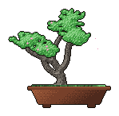

<div align="center">
  

  # Hey, I'm Antroline 👋

  **Full-Stack & Blockchain Developer**

  *I build dependable products where thoughtful interfaces meet decentralized infrastructure.*
</div>

---

### A little about me

- 🌱 Currently learning **Rust, Soroban & blockchain infrastructure**
- 🔭 Building **LumenRise**
- 🤝 Open to collaborating on **open-source projects**
- 💬 Ask me about **TypeScript, React, Next.js, Stellar & Soroban**
- 🧩 Happy to help with **system design and scalable architecture**
- ☕ Programmer. Cannot continue without espresso.

### Toolbox

<p align="center">
  
  <br />
  
</p>

### What I care about

```text
clean architecture  ·  useful open source  ·  resilient systems
human interfaces    ·  decentralized tech  ·  excellent coffee
```

<div align="center">
  <a href="mailto:antrolinee@gmail.com"></a>
  <a href="https://github.com/antroline"></a>
</div>

<br />

<div align="center">
  
</div>
